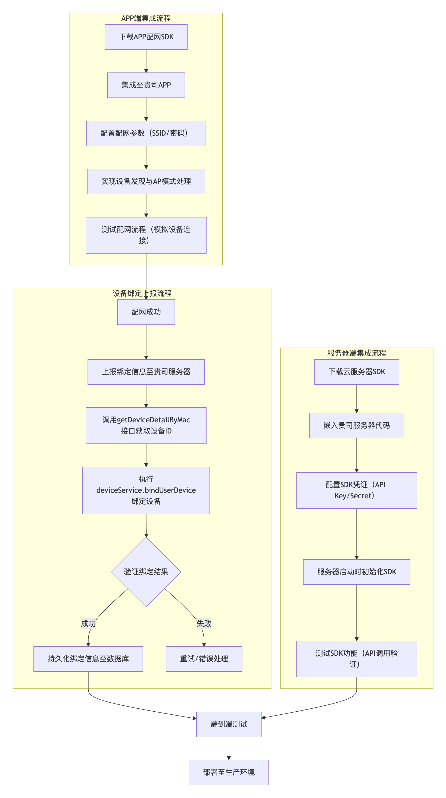

# 海曼智能家居 SDK Demo（heiman-sdk-demo）

> **Languages:** [English](../README.md) · [简体中文](README_CH.md) · [Русский](README_RU.md) · [Deutsch](README_DE.md) · [Français](README_FR.md) · [Italiano](README_IT.md) · [العربية](README_AR.md) · [Español](README_ES.md) · [Português](README_PT.md) · [Polski](README_PL.md)

| 文档信息 | 内容 |
|---|---|
| 文档语言 | 简体中文 |
| 适用版本 | 海曼智能家居 SDK **v1.0.4**（`heiman-sdk-demo`） |
| 运行环境 | JDK 8+、Maven 3.6+ |
| 文档状态 | 正式文档 |
| 更新日期 | 2026-11-13 |

## 目录

1. 概述
2. 运行前必读（必改项）
3. Demo 运行流程
4. 项目结构
5. 快速开始
6. 配置项说明
7. 核心代码说明
8. MQTT 回调一览
9. 常见问题
10. 凭证与安全建议
11. 技术支持
12. 版本历史与许可证

## 1. 概述

`heiman-sdk-demo` 是海曼智能家居 SDK（v1.0.4）的官方综合演示工程，以 `com.heiman.sdk.demo.DemoApplication` 为主入口，完整演示服务端接入的两条核心链路：

- **RESTful 设备管理**：OAuth2 自动登录、设备绑定 / 解绑、设备列表分页查询、产品列表与物模型（ThingModel）解析。
- **MQTT 设备接入**：MQTT 客户端初始化、属性读取 / 写入指令下发，以及属性上报、事件上报、子设备管理、固件升级、场景、时间同步等 30+ 个回调的注册与处理。

此外还包含物模型加载演示（`DeviceDemo`）、Web API / OAuth2 调用模式演示（`client/` 包）以及实体订阅 / 命令注册模式演示（`server/` 包）。

**适用读者：** 首次对接海曼 IoT 平台的服务端工程师。本文档涵盖环境要求、凭证配置、编译与运行步骤、配置项说明、核心代码走读、回调清单、故障排查与安全建议。文中的命令与代码片段均来自本工程，按第 2 节替换占位内容后即可直接使用。

SDK 整体集成流程（APP 端配网 → 设备绑定上报 → 服务端集成）如下图：



## 2. 运行前必读（必改项）

> ⚠️ **仓库仅提供占位内容。运行 Demo 前必须替换以下三项，否则无法正常登录与绑定设备。**

| # | 项目 | 文件 / 位置 | 默认值 | 操作 |
|---|---|---|---|---|
| 1 | 应用凭证 | `src/main/resources/sdk-config.properties` | `YOUR_APP_ID` / `YOUR_SECURE_KEY` | 替换为 IoT 平台颁发的真实 `appId` / `secureKey`（**必改**） |
| 2 | 设备 SN | `DemoApplication#testHttpClient()` | `String deviceSn = "xxxxxxx"` | 替换为真实可绑定的设备 SN |
| 3 | 测试属性 | `DemoApplication#createTestProperties()` | `FreezingPointEnable` | 按你自己产品物模型中定义的属性 ID 调整 |

**为什么必须替换：** `SdkConfig` 只拦截配置文件缺失、空值以及未替换的 `${...}` 占位符；`YOUR_APP_ID` / `YOUR_SECURE_KEY` 非空，会被当成合法凭证直接发送到平台。因此不替换并不会报「缺少配置」，而是表现为 OAuth2 登录 / 鉴权失败（例如 HTTP 401）。完整配置流程见 5.2 节。

## 3. Demo 运行流程

`com.heiman.sdk.demo.DemoApplication#main` 是主入口，按以下顺序执行：

1. **DeviceDemo**：从 SDK 内置资源（`DeviceModels`）加载网关 / 烟雾 / CO / 温感 / 遥控器五类物模型，打印属性、事件、功能概览。
2. **testHttpClient()（RESTful）**：
  - 从 `sdk-config.properties` 构建 `ClientConfig`，创建 `HeimanRestfulClient` 并自动完成 OAuth2 登录；
  - 通过 `getCurrentToken()` 获取 accessToken 与 userId；
  - 调用 `deviceService.bindUserDevice(deviceSn)` 绑定设备；
  - 分页查询设备列表（`queryDeviceList`），遍历打印设备信息；
  - 查询产品列表（`getProductList`），将产品 `metadata` 解析为 `ThingModel` 并按 productId 缓存；
  - 最后调用 `unbindUserDevice(deviceSn)` 解绑。**注意：v1.0.4 代码中该解绑调用是生效的（未注释）；需要观察 MQ 回调消息时，请手动注释掉 `testHttpClient()` 末尾的解绑调用（含 `ApiResult unbind = ...` 及其打印语句）。**
3. **testMqtt()（MQTT）**：
  - 由 `SdkConfig.get().toMqttConfig(userId)` 构建 `MqttConfig`（broker 由 SDK 内置，无需配置地址）；
  - 实现 `MqttCallback` 全部回调方法（属性读写回复、事件 / 属性上报、子设备上下线、固件升级进度、场景增删改、连接状态等）；
  - 调用 `HeimanMqttClient.getInstance().init(mqttConfig, callback)` 完成初始化；
  - 遍历步骤 2 查询到的设备列表，根据产品物模型组装测试属性（示例使用 `FreezingPointEnable` 属性，请按你自己产品物模型调整 `createTestProperties()`），依次下发 `propertiesWrite` 与 `propertiesRead`。
4. **退出清理**：注册 JVM shutdownHook，退出时调用 `HeimanMqttClient.getInstance().shutdown()` 与 `restfulClient.close()` 优雅释放连接资源。

## 4. 项目结构

```
heiman-sdk-demo/
├── src/main/java/com/heiman/sdk/demo/
│   ├── DemoApplication.java          # Main entry: full RESTful + MQTT flow
│   ├── DeviceDemo.java               # Device thing-model loading & overview demo
│   ├── ProductDemo.java              # Product list query demo (real RESTful call)
│   ├── SdkConfig.java                # Runtime credential loader (sdk-config.properties)
│   ├── client/
│   │   ├── WebApiClientDemo.java     # Web API call-pattern demo (simulated output)
│   │   └── WebOAuth2ClientDemo.java  # OAuth2 call-pattern demo (simulated output)
│   ├── model/                        # Thing-model POJOs (9 files)
│   │   ├── ThingModel.java           #   Thing model (tags/properties/events/functions)
│   │   ├── Property.java             #   Property
│   │   ├── Function.java             #   Function
│   │   ├── FunctionInput.java        #   Function input
│   │   ├── Event.java                #   Event
│   │   ├── ValueType.java            #   Value type
│   │   ├── Tag.java                  #   Tag
│   │   ├── Expands.java              #   Expands
│   │   └── Element.java              #   Element
│   └── server/
│       └── EntitySubscribeDemo.java  # Entity subscription / command registration demo (simulated)
├── src/main/resources/
│   └── sdk-config.properties         # Runtime credentials (appId / secureKey; placeholders by default, replace before running)
├── libs/
│   ├── heiman-sdk-mqtt-1.0.4.jar     # MQTT module (system scope)
│   └── heiman-sdk-restful-1.0.4.jar  # RESTful module (system scope)
├── image/
│   ├── img.png                       # Integration flow diagram (EN, used by README.md and translations in doc/)
│   └── img_1.png                     # Integration flow diagram (CN, used by doc/README_CH.md)
├── doc/
│   ├── README_CH.md                  # 简体中文
│   ├── README_RU.md                  # Русский
│   ├── README_DE.md                  # Deutsch
│   ├── README_FR.md                  # Français
│   ├── README_IT.md                  # Italiano
│   ├── README_AR.md                  # العربية
│   ├── README_ES.md                  # Español
│   ├── README_PT.md                  # Português
│   └── README_PL.md                  # Polski
├── README.md                         # English (default)
├── .gitignore                        # Ignore rules (build output, IDE, secrets)
├── LICENSE                           # Apache-2.0 (source & docs only)
├── NOTICE                            # Licence scope + third-party notices
├── CHANGELOG.md                      # Version history
├── RELEASE_NOTES.md                  # v1.0.4 release notes
├── sbom.json                         # CycloneDX SBOM (mvn -P sbom package)
└── pom.xml
```

## 5. 快速开始

### 5.1 环境要求

- JDK 8+
- Maven 3.6+（或直接使用 IDEA 打开工程）
- 海曼 IoT 平台颁发的应用凭证（`appId` / `secureKey`）
- 一台可绑定的真实设备（deviceSn）
- 可访问海曼 IoT 平台的网络；RESTful 服务地址与 MQTT broker 均由 SDK 内置

### 5.2 配置运行凭证

> ⚠️ **必须修改 `src/main/resources/sdk-config.properties`**：把默认占位符替换为 IoT 平台颁发的真实应用凭证，再编译运行。

```properties
# Before (repository defaults)
appId=YOUR_APP_ID
secureKey=YOUR_SECURE_KEY

# After (example — use your own real credentials)
appId=YOUR_REAL_APP_ID
secureKey=YOUR_REAL_SECURE_KEY
```

修改要点：

- **不替换不会报「缺少配置」**：`SdkConfig` 只拦截配置缺失、空值以及未替换的 `${...}` 占位符；`YOUR_APP_ID` / `YOUR_SECURE_KEY` 会被当成合法值直接用于登录，表现为 OAuth2 登录失败或鉴权错误（401），而不是明确的凭证异常；
- 仓库不内置任何真实凭证；文件缺失或值为空时，SDK 会抛出 `缺少有效的 SDK 运行凭证配置: appId/secureKey`；
- 保持键名 `appId` / `secureKey` 不变，文件使用 UTF-8 编码；`tenantId` 沿用 SDK 内置默认值，MQTT broker 与 RESTful 服务地址同样由 SDK 内置，**无需在本文件添加其他配置项**；
- 修改后重新执行 `mvn compile`（或在 IDEA 中重新构建）再运行，确保 classpath 下 `target/classes/sdk-config.properties` 已同步为最新内容；
- `deviceSn` 不在该配置文件中：需同步把 `DemoApplication#testHttpClient()` 里的 `String deviceSn = "xxxxxxx"` 改为真实有效、且未被其他用户绑定的设备 SN；
- 请勿把真实凭证提交到代码仓库（仓库只保留占位符）；若凭证疑似泄露，请在 IoT 平台重置 `secureKey`；
- 通过 IoT 平台 `/application/{id}/sdk/download` 打包下载 SDK Demo 时，该文件会被自动替换为对应应用的真实凭证，**这种情况下无需手动修改**。

### 5.3 编译

```bash
cd heiman-sdk-demo
mvn compile
```

SDK 依赖以 system scope 形式存放在 `libs/` 目录（仅含 SDK 自身类，不含第三方依赖），无需额外安装到本地仓库。

### 5.4 运行

> 运行前确认：已完成 5.2 节的 `sdk-config.properties` 凭证替换并重新编译，且 `DemoApplication` 中的 `deviceSn` 与 `createTestProperties()` 已按你的设备 / 物模型调整。

推荐使用 IDEA 打开工程后直接运行：

```
com.heiman.sdk.demo.DemoApplication#main
```

预期控制台输出依次为：内置物模型概览、登录成功后的脱敏令牌与 userId、分页设备列表、含物模型属性的产品列表、MQTT 连接成功提示，以及设备消息到达时的回调日志。进程会持续运行以便观察回调，按 `Ctrl+C` 退出时由 shutdownHook 释放连接资源。

### 5.5 可单独运行的演示类

| 类 | 说明 |
|---|---|
| `DemoApplication` | 主入口：RESTful + MQTT 全流程（真实调用） |
| `ProductDemo` | 产品列表查询（真实 RESTful 调用） |
| `DeviceDemo` | 物模型加载与概览打印 |
| `client.WebApiClientDemo` / `client.WebOAuth2ClientDemo` | Web API / OAuth2 调用模式演示（模拟输出） |
| `server.EntitySubscribeDemo` | 实体订阅 / 命令注册模式演示（模拟输出） |

> 注意：仅 `DemoApplication` 与 `ProductDemo` 会发起真实 RESTful / MQTT 调用；`DeviceDemo` 基于 SDK 内置物模型资源，`client/*` 与 `server/EntitySubscribeDemo` 为本地模拟输出，均不产生真实网络请求。

## 6. 配置项说明

| 配置项 | 来源 | 是否必改 | 说明 |
|---|---|---|---|
| `appId` | `src/main/resources/sdk-config.properties` | 是 | IoT 平台颁发的应用 ID，由 `SdkConfig.getAppId()` 读取 |
| `secureKey` | `src/main/resources/sdk-config.properties` | 是 | 应用密钥，由 `SdkConfig.getSecureKey()` 读取；严禁提交到仓库 |
| `tenantId` | SDK 内置（`HeimanEndpoints.DEFAULT_TENANT_ID`） | 否 | 由 `SdkConfig.getTenantId()` 返回，不从配置文件读取 |
| RESTful 地址 / MQTT broker | SDK 内置 | 否 | 无需配置地址；`MqttConfig` 只需 appId、secureKey、tenantId 与 userId |
| `deviceSn` | `DemoApplication#testHttpClient()` | 是 | 待绑定设备 SN，默认值 `xxxxxxx` 为占位符 |
| `userId` | `restfulClient.getCurrentToken().getUserId()` | 否 | 登录用户 ID，运行时传入 `toMqttConfig(userId)` |
| 属性 ID / 属性值 | `DemoApplication#createTestProperties()` | 物模型不同则必改 | 必须与产品物模型定义的属性 ID 和值类型一致 |

`SdkConfig` 提供 `toClientConfig()`（连接超时 30 s、读写超时 60 s、开启日志）与 `toMqttConfig(userId)`。RESTful 与 MQTT 两个客户端由此共用同一凭证来源：`sdk-config.properties`。

## 7. 核心代码说明

### 7.1 RESTful 客户端（自动登录）

```java
// Build the client config (credentials come from sdk-config.properties)
ClientConfig clientConfig = SdkConfig.get().toClientConfig();

// Create the RESTful client — OAuth2 login happens automatically in the constructor
HeimanRestfulClient restfulClient = new HeimanRestfulClient(clientConfig);

// Get the current token information
OAuth2Token token = restfulClient.getCurrentToken();
String userId = token.getUserId();

// Bind a device
DeviceService deviceService = restfulClient.getDeviceService();
deviceService.bindUserDevice(deviceSn);

// Query the device list with pagination
DeviceListQueryParam queryParam = new DeviceListQueryParam();
queryParam.getHelp().setPageIndex(0);
queryParam.getHelp().setPageSize(10);
PageResult<DeviceDetail> deviceList = deviceService.queryDeviceList(queryParam);

// Query the product list and parse thing models
ProductService productService = restfulClient.getProductService();
List<ProductInfo> products = productService.getProductList();
ThingModel thingModel = JSONObject.parseObject(product.getMetadata(), ThingModel.class);
```

### 7.2 MQTT 客户端初始化与回调

```java
// The broker is built into the SDK; only the logged-in userId is required
MqttConfig mqttConfig = SdkConfig.get().toMqttConfig(userId);

MqttCallback callback = new MqttCallback() {
    @Override
    public void onPropertiesReadReply(String productId, String deviceId,
                                      PropertiesReadResponse response) { ... }

    @Override
    public void onPropertiesWriteReply(String productId, String deviceId,
                                       PropertiesWriteResponse response) { ... }

    @Override
    public void onEventReport(String productId, String deviceId, String eventId,
                              EventReportRequest request) { ... }

    @Override
    public void onPropertiesReport(String productId, String deviceId,
                                   PropertiesReportRequest request) { ... }

    @Override
    public void onChildOnline(String productId, String deviceId, String childDeviceId,
                              ChildDeviceOnlineRequest request) { ... }

    @Override
    public void onFirmwareUpgradeProgress(String productId, String deviceId,
                                          FirmwareUpgradeProgressRequest request) { ... }

    @Override
    public void onConnected(boolean reconnect, String serverURI) { ... }

    @Override
    public void onConnectionLost(Throwable cause) { ... }

    // Remaining callbacks (sub-device management, topology, scenes, time sync, log report,
    // etc.) — see the full implementation in DemoApplication
};

HeimanMqttClient.getInstance().init(mqttConfig, callback);
```

### 7.3 属性读取 / 写入

```java
// Property write: keys are thing-model property IDs; value types must match the model
PropertiesWriteRequest writeRequest = new PropertiesWriteRequest();
writeRequest.setProperties(properties);
HeimanMqttClient.getInstance().propertiesWrite(productId, deviceId, writeRequest);

// Property read
PropertiesReadRequest readRequest = new PropertiesReadRequest();
readRequest.setProperties(new ArrayList<>(properties.keySet()));
HeimanMqttClient.getInstance().propertiesRead(productId, deviceId, readRequest);
```

指令执行结果通过 `onPropertiesWriteReply` / `onPropertiesReadReply` 回调异步返回；下发指令后请保持进程运行，以便观察回复。

### 7.4 优雅退出

```java
Runtime.getRuntime().addShutdownHook(new Thread(() -> {
    HeimanMqttClient.getInstance().shutdown();   // Release the MQTT connection
    restfulClient.close();                       // Release the RESTful connection pool
}));
```

## 8. MQTT 回调一览

`DemoApplication#testMqtt()` 完整实现了 `MqttCallback` 的 30+ 个回调，按下表分类；表中列出的代表性方法名均可在源码中找到。

| 分类 | 代表性回调 | 作用 |
|---|---|---|
| 连接 | `onConnected`、`onConnectionLost`、`onDeliveryComplete` | 连接状态、重连通知、消息投递确认 |
| 属性与功能 | `onPropertiesReadReply`、`onPropertiesWriteReply`、`onFunctionInvokeReply` | 服务端下发指令的回复 |
| 数据上报 | `onPropertiesReport`、`onEventReport`、`onMetadataDerived`、`onTagsUpdate`、`onDeviceOnline`、`onDeviceOffline` | 设备侧数据、事件、元数据与上下线状态 |
| 子设备 | `onChildOnline`、`onChildOffline`、`onChildRegister`、`onChildUnregister`、`onChildPropertiesReport`、`onChild*Reply`、`onTopoGet` | 子设备生命周期、拓扑与子设备消息 |
| 固件 | `onFirmwareUpgradeProgress`、`onFirmwarePull`、`onFirmwareReport`、`onFirmwareReadReply` | OTA 升级进度与固件信息 |
| 场景与系统 | `onSceneAddReply`、`onSceneUpdateReply`、`onSceneDeleteReply`、`onSceneFireReply`、`onSceneList`、`onTimeSync`、`onLogReport`、`onSysResetReport` | 场景管理、时间同步、日志与复位上报 |

> 注意：Demo 中的回调仅打印收到的消息内容。实际接入时应替换为你的业务逻辑（持久化、告警、转发等）。

## 9. 常见问题

### Q1: 启动报“缺少有效的 SDK 运行凭证配置”，或 OAuth2 登录失败 / 401

**A:** 优先检查 `src/main/resources/sdk-config.properties`：

1. 文件缺失、`appId` / `secureKey` 为空或仍是 `${...}` 占位符 → 填入真实凭证并重新编译；
2. 文件仍是默认占位符 `YOUR_APP_ID` / `YOUR_SECURE_KEY` → 占位符不会被校验拦截，会被当作真实凭证发起登录，因此表现为登录 / 鉴权失败而不是配置异常，必须替换为真实凭证；
3. 凭证与设备所属应用不一致时同样会鉴权失败，请确认使用的是 IoT 平台颁发给该应用的凭证。

### Q2: 设备绑定失败

**A:** 确认 `DemoApplication#testHttpClient()` 中的 `String deviceSn = "xxxxxxx"` 已替换为真实有效的设备 SN，且设备未被其他用户绑定；同时确认 `sdk-config.properties` 已按 5.2 节修改。

### Q3: MQ 回调收不到消息

**A:** `testHttpClient()` 末尾的 `unbindUserDevice(deviceSn)` 会解绑设备，导致后续收不到设备消息。v1.0.4 代码中该调用**未注释**，需要调试 MQ 回调时请手动注释掉（含 `ApiResult unbind = ...` 及打印语句）。另外确认凭证有效、`deviceSn` 为真实设备 SN。

### Q4: 属性写入无响应

**A:** 依次检查：设备是否在线；属性 ID 是否与产品物模型一致；值类型是否符合物模型定义。示例中的 `FreezingPointEnable` 仅为演示，请按你的产品物模型调整 `createTestProperties()`。

### Q5: 连接断开

**A:** 通过 `onConnectionLost` 回调感知断开原因；重连成功后 SDK 会通过 `onConnected(reconnect, serverURI)` 通知（`reconnect = true`）。

### Q6: Maven 无法解析 SDK 依赖

**A:** 两个 SDK jar 以 `system` scope 从 `libs/` 引入。请确认 `libs/heiman-sdk-mqtt-1.0.4.jar` 与 `libs/heiman-sdk-restful-1.0.4.jar` 存在于上述精确路径，并在 `heiman-sdk-demo` 目录内构建（`${project.basedir}` 必须指向该目录）。

## 10. 凭证与安全建议

- 仓库只保留占位凭证；切勿把真实 `appId` / `secureKey` 提交到版本库，如需在版本库外保存真实凭证，请将本地配置文件加入 `.gitignore`。
- 通过 `/application/{id}/sdk/download` 打包下载时，平台会把 `sdk-config.properties` 替换为该应用的真实凭证，请妥善保管下载包。
- `DemoApplication` 仅打印脱敏后的令牌（`abcd****wxyz`）；生产环境切勿打印完整令牌、`secureKey` 或个人信息。
- 若凭证疑似泄露，请立即在 IoT 平台重置 `secureKey`，并使用新值重新编译 / 部署 Demo。
- Demo 会真实绑定、解绑设备并下发指令，请使用专用测试应用与测试设备，不要对生产数据运行。
- `target/classes/sdk-config.properties` 是凭证的编译副本，分享或归档工程前请清理构建产物。

## 11. 技术支持

- **邮箱：** heimanapp1@heiman.cn
- **官网：** https://www.heimanhome.com

## 12. 版本历史与许可证

### 12.1 版本历史

See [../CHANGELOG.md](../CHANGELOG.md) for the full history and [../RELEASE_NOTES.md](../RELEASE_NOTES.md) for this release.

- **v1.0.4：** 当前版本
  - 运行凭证统一由 `sdk-config.properties` 管理，默认仅含占位符，运行前必须替换为真实 `appId` / `secureKey`
  - 主入口 `DemoApplication` 整合 RESTful 与 MQTT 全流程
  - 支持 IoT 平台 `/application/{id}/sdk/download` 打包时自动替换为对应应用的真实凭证
  - JVM 退出时通过 shutdownHook 优雅释放连接资源
  - MQTT 回调全面覆盖（属性 / 事件 / 子设备 / 固件 / 场景等）

### 12.2 许可证

本仓库源码与文档采用 **Apache License 2.0** 许可证，详见 [../LICENSE](../LICENSE)；`libs/` 下的专有 SDK 二进制与 `image/` 下的图示**不在**授权范围内，适用范围与第三方声明见 [../NOTICE](../NOTICE)。
