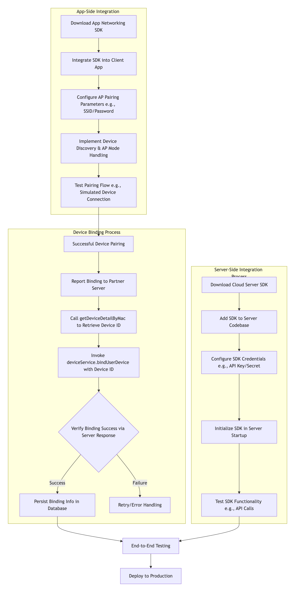

# Demo dell'SDK Heiman per la domotica (heiman-sdk-demo)

> **Languages:** [English](../README.md) · [简体中文](README_CH.md) · [Русский](README_RU.md) · [Deutsch](README_DE.md) · [Français](README_FR.md) · [Italiano](README_IT.md) · [العربية](README_AR.md) · [Español](README_ES.md) · [Português](README_PT.md) · [Polski](README_PL.md)

| Informazioni sul documento | Valore |
|---|---|
| Lingua | Italiano |
| Si applica a | SDK Heiman per la domotica **v1.0.4** (`heiman-sdk-demo`) |
| Ambiente di esecuzione | JDK 8+, Maven 3.6+ |
| Stato | Documentazione ufficiale |
| Ultimo aggiornamento | 2026-11-13 |

## Indice

1. Panoramica
2. Prima dell'esecuzione (modifiche obbligatorie)
3. Flusso del Demo
4. Struttura del progetto
5. Avvio rapido
6. Riferimento alla configurazione
7. Analisi del codice principale
8. Riferimento ai callback MQTT
9. Domande frequenti
10. Note su credenziali e sicurezza
11. Supporto tecnico
12. Cronologia delle versioni e licenza

## 1. Panoramica

`heiman-sdk-demo` è il progetto dimostrativo completo e ufficiale dell'SDK Heiman per la domotica (v1.0.4). Strutturato attorno a `com.heiman.sdk.demo.DemoApplication`, illustra dall'inizio alla fine i due flussi di integrazione principali sul lato server:

- **Gestione dei dispositivi RESTful**: accesso OAuth2 automatico, associazione / dissociazione dei dispositivi, query paginata dell'elenco dei dispositivi, elenco dei prodotti e analisi del ThingModel.
- **Accesso ai dispositivi MQTT**: inizializzazione del client MQTT, comandi di lettura / scrittura delle proprietà e registrazione e gestione di oltre 30 callback relativi a segnalazioni di proprietà, segnalazioni di eventi, gestione dei sottodispositivi, aggiornamenti del firmware, scenari, sincronizzazione dell'ora e altro ancora.

Include inoltre una dimostrazione di caricamento del ThingModel (`DeviceDemo`), dimostrazioni degli schemi di chiamata Web API / OAuth2 (pacchetto `client/`) e una dimostrazione della sottoscrizione di entità / registrazione dei comandi (pacchetto `server/`).

**Destinatari:** ingegneri lato server che integrano per la prima volta la piattaforma IoT Heiman. Il presente documento illustra i prerequisiti, la configurazione delle credenziali, le fasi di compilazione ed esecuzione, le voci di configurazione, l'analisi del codice, l'elenco dei callback, la risoluzione dei problemi e le note sulla sicurezza. Tutti i comandi e i frammenti di codice provengono da questo demo e sono pronti all'uso dopo aver sostituito i segnaposto elencati nella sezione 2.

Il flusso complessivo di integrazione dell'SDK (configurazione lato APP → associazione e segnalazione dei dispositivi → integrazione lato server) è illustrato di seguito:



## 2. Prima dell'esecuzione (modifiche obbligatorie)

> ⚠️ **Il repository contiene soltanto segnaposto. Prima di poter eseguire correttamente il Demo è necessario sostituire tre elementi.**

| # | Elemento | File / posizione | Valore predefinito | Azione |
|---|---|---|---|---|
| 1 | Credenziali dell'applicazione | `src/main/resources/sdk-config.properties` | `YOUR_APP_ID` / `YOUR_SECURE_KEY` | Sostituire con i reali `appId` / `secureKey` rilasciati dalla piattaforma IoT Heiman (**obbligatorio**) |
| 2 | SN del dispositivo | `DemoApplication#testHttpClient()` | `String deviceSn = "xxxxxxx"` | Sostituire con un SN di dispositivo reale e associabile |
| 3 | Proprietà di test | `DemoApplication#createTestProperties()` | `FreezingPointEnable` | Adattare a un ID di proprietà definito nel ThingModel del proprio prodotto |

**Perché è importante:** `SdkConfig` rifiuta soltanto un file mancante, valori vuoti e segnaposto `${...}` non risolti. `YOUR_APP_ID` / `YOUR_SECURE_KEY` non sono vuoti, quindi vengono accettati come credenziali valide e inviati alla piattaforma. Lasciarli invariati **non** genera un errore di "configurazione mancante": semplicemente l'accesso / l'autenticazione OAuth2 non riesce (ad esempio con HTTP 401). Per la procedura di configurazione completa si veda la sezione 5.2.

## 3. Flusso del Demo

`com.heiman.sdk.demo.DemoApplication#main` è il punto di ingresso principale e viene eseguito nel seguente ordine:

1. **DeviceDemo**: carica cinque ThingModel integrati (gateway / fumo / CO / calore / telecomando) dalle risorse integrate dell'SDK (`DeviceModels`) e stampa una panoramica delle relative proprietà, eventi e funzioni.
2. **testHttpClient() (RESTful)**:
   - Crea un `ClientConfig` da `sdk-config.properties`, istanzia `HeimanRestfulClient` e completa automaticamente l'accesso OAuth2;
   - Ottiene l'access token e lo userId tramite `getCurrentToken()`;
   - Associa un dispositivo con `deviceService.bindUserDevice(deviceSn)`;
   - Interroga l'elenco dei dispositivi con paginazione (`queryDeviceList`) e stampa i dettagli dei dispositivi;
   - Interroga l'elenco dei prodotti (`getProductList`), analizza il `metadata` di ogni prodotto in un `ThingModel` e li memorizza nella cache per productId;
   - Infine dissocia il dispositivo tramite `unbindUserDevice(deviceSn)`. **Nota: nella v1.0.4 questa chiamata di dissociazione è attiva (non commentata); quando è necessario osservare i messaggi dei callback MQ, commentare manualmente la chiamata di dissociazione alla fine di `testHttpClient()` (inclusi `ApiResult unbind = ...` e l'istruzione di stampa successiva).**
3. **testMqtt() (MQTT)**:
   - Crea un `MqttConfig` tramite `SdkConfig.get().toMqttConfig(userId)` (il broker è integrato nell'SDK, non è necessario configurare alcun URL);
   - Implementa tutti i metodi di `MqttCallback` (risposte di lettura / scrittura delle proprietà, segnalazioni di eventi / proprietà, sottodispositivi online / offline, avanzamento dell'aggiornamento del firmware, aggiunta / modifica / eliminazione degli scenari, stato della connessione, ecc.);
   - Inizializza con `HeimanMqttClient.getInstance().init(mqttConfig, callback)`;
   - Scorre l'elenco dei dispositivi ottenuto al passaggio 2, costruisce le proprietà di test dal ThingModel del prodotto (nell'esempio si usa la proprietà `FreezingPointEnable`; adattare `createTestProperties()` al proprio modello di prodotto), quindi invia i comandi `propertiesWrite` e `propertiesRead`.
4. **Pulizia all'uscita**: un hook di arresto della JVM rilascia le risorse in modo graduale chiamando `HeimanMqttClient.getInstance().shutdown()` e `restfulClient.close()`.

## 4. Struttura del progetto

```
heiman-sdk-demo/
├── src/main/java/com/heiman/sdk/demo/
│   ├── DemoApplication.java          # Main entry: full RESTful + MQTT flow
│   ├── DeviceDemo.java               # Device thing-model loading & overview demo
│   ├── ProductDemo.java              # Product list query demo (real RESTful call)
│   ├── SdkConfig.java                # Runtime credential loader (sdk-config.properties)
│   ├── client/
│   │   ├── WebApiClientDemo.java     # Web API call-pattern demo (simulated output)
│   │   └── WebOAuth2ClientDemo.java  # OAuth2 call-pattern demo (simulated output)
│   ├── model/                        # Thing-model POJOs (9 files)
│   │   ├── ThingModel.java           #   Thing model (tags/properties/events/functions)
│   │   ├── Property.java             #   Property
│   │   ├── Function.java             #   Function
│   │   ├── FunctionInput.java        #   Function input
│   │   ├── Event.java                #   Event
│   │   ├── ValueType.java            #   Value type
│   │   ├── Tag.java                  #   Tag
│   │   ├── Expands.java              #   Expands
│   │   └── Element.java              #   Element
│   └── server/
│       └── EntitySubscribeDemo.java  # Entity subscription / command registration demo (simulated)
├── src/main/resources/
│   └── sdk-config.properties         # Runtime credentials (appId / secureKey; placeholders by default, replace before running)
├── libs/
│   ├── heiman-sdk-mqtt-1.0.4.jar     # MQTT module (system scope)
│   └── heiman-sdk-restful-1.0.4.jar  # RESTful module (system scope)
├── image/
│   ├── img.png                       # Integration flow diagram (EN, used by README.md and translations in doc/)
│   └── img_1.png                     # Integration flow diagram (CN, used by doc/README_CH.md)
├── doc/
│   ├── README_CH.md                  # 简体中文
│   ├── README_RU.md                  # Русский
│   ├── README_DE.md                  # Deutsch
│   ├── README_FR.md                  # Français
│   ├── README_IT.md                  # Italiano
│   ├── README_AR.md                  # العربية
│   ├── README_ES.md                  # Español
│   ├── README_PT.md                  # Português
│   └── README_PL.md                  # Polski
├── README.md                         # English (default)
├── .gitignore                        # Ignore rules (build output, IDE, secrets)
├── LICENSE                           # Apache-2.0 (source & docs only)
├── NOTICE                            # Licence scope + third-party notices
├── CHANGELOG.md                      # Version history
├── RELEASE_NOTES.md                  # v1.0.4 release notes
├── sbom.json                         # CycloneDX SBOM (mvn -P sbom package)
└── pom.xml
```

## 5. Avvio rapido

### 5.1 Requisiti

- JDK 8+
- Maven 3.6+ (oppure è sufficiente aprire il progetto in IDEA)
- Credenziali dell'applicazione (`appId` / `secureKey`) rilasciate dalla piattaforma IoT Heiman
- Un dispositivo reale associabile (deviceSn)
- Accesso di rete alla piattaforma IoT Heiman; gli endpoint RESTful e il broker MQTT sono integrati nell'SDK

### 5.2 Configurazione delle credenziali

> ⚠️ **È necessario modificare `src/main/resources/sdk-config.properties`**: sostituire i segnaposto predefiniti con le credenziali reali dell'applicazione rilasciate dalla piattaforma IoT Heiman prima di compilare ed eseguire.

```properties
# Before (repository defaults)
appId=YOUR_APP_ID
secureKey=YOUR_SECURE_KEY

# After (example — use your own real credentials)
appId=YOUR_REAL_APP_ID
secureKey=YOUR_REAL_SECURE_KEY
```

Elenco di controllo:

- **Lasciare i segnaposto NON genera un errore di "configurazione mancante"**: `SdkConfig` rifiuta soltanto un file mancante, valori vuoti e segnaposto `${...}` non risolti. `YOUR_APP_ID` / `YOUR_SECURE_KEY` vengono considerati valori validi e inviati alla piattaforma, pertanto l'accesso / l'autenticazione OAuth2 non riesce (ad es. 401) invece di segnalare un chiaro errore sulle credenziali;
- Il repository non include credenziali reali; se il file manca o un valore è vuoto, l'SDK genera `missing valid SDK credential configuration: appId/secureKey`;
- Mantenere invariati i nomi delle chiavi `appId` / `secureKey` e salvare il file in UTF-8. `tenantId` utilizza il valore predefinito integrato nell'SDK e anche il broker MQTT e gli endpoint RESTful sono integrati nell'SDK — **non aggiungere altre voci a questo file**;
- Dopo la modifica, eseguire nuovamente `mvn compile` (o ricompilare in IDEA) affinché `target/classes/sdk-config.properties` nel classpath sia aggiornato;
- `deviceSn` non è presente in questo file: sostituire anche `String deviceSn = "xxxxxxx"` in `DemoApplication#testHttpClient()` con un SN di dispositivo reale, associabile e non associato a un altro utente;
- Non inserire mai credenziali reali nel repository (qui sono mantenuti solo i segnaposto); se si sospetta una fuga di credenziali, ruotare `secureKey` sulla piattaforma IoT;
- Quando il Demo dell'SDK viene pacchettizzato e scaricato dalla piattaforma IoT tramite `/application/{id}/sdk/download`, questo file viene sostituito automaticamente con le credenziali reali di tale applicazione — **in questo caso non è necessaria alcuna modifica manuale**.

### 5.3 Compilazione

```bash
cd heiman-sdk-demo
mvn compile
```

Le dipendenze dell'SDK sono fornite come jar con scope `system` nella directory `libs/` (binari SDK non offuscati), pertanto non è necessario installarle nel repository locale.

### 5.4 Esecuzione

> Prima dell'esecuzione, verificare che il passaggio 5.2 sia stato completato (`sdk-config.properties` sostituito con le credenziali reali e progetto ricompilato) e che `deviceSn` e `createTestProperties()` in `DemoApplication` siano stati adattati al proprio dispositivo / ThingModel.

La modalità consigliata è aprire il progetto in IDEA ed eseguire:

```
com.heiman.sdk.demo.DemoApplication#main
```

L'output previsto nella console, nell'ordine: la panoramica dei ThingModel integrati, un access token mascherato e lo userId dopo l'accesso, l'elenco paginato dei dispositivi, l'elenco dei prodotti con le proprietà del ThingModel analizzate, il messaggio di connessione MQTT e i log dei callback all'arrivo dei messaggi dei dispositivi. Il processo resta in esecuzione per consentire l'osservazione dei callback — premere `Ctrl+C` per uscire; a quel punto l'hook di arresto rilascia entrambe le connessioni.

### 5.5 Classi demo

| Classe | Descrizione |
|---|---|
| `DemoApplication` | Punto di ingresso principale: flusso RESTful + MQTT completo (chiamate reali) |
| `ProductDemo` | Query dell'elenco dei prodotti (chiamata RESTful reale) |
| `DeviceDemo` | Caricamento del ThingModel e stampa della panoramica |
| `client.WebApiClientDemo` / `client.WebOAuth2ClientDemo` | Dimostrazioni degli schemi di chiamata Web API / OAuth2 (output simulato) |
| `server.EntitySubscribeDemo` | Dimostrazione della sottoscrizione di entità / registrazione dei comandi (output simulato) |

> Nota: solo `DemoApplication` e `ProductDemo` eseguono chiamate RESTful / MQTT reali. `DeviceDemo` utilizza i ThingModel integrati nell'SDK, mentre `client/*` e `server/EntitySubscribeDemo` stampano un output locale simulato; nessuno di essi genera richieste di rete reali.

## 6. Riferimento alla configurazione

| Elemento | Origine | Da modificare | Descrizione |
|---|---|---|---|
| `appId` | `src/main/resources/sdk-config.properties` | Sì | ID dell'applicazione rilasciato dalla piattaforma IoT Heiman; letto da `SdkConfig.getAppId()` |
| `secureKey` | `src/main/resources/sdk-config.properties` | Sì | Segreto dell'applicazione; letto da `SdkConfig.getSecureKey()`; non inserirlo mai nel repository |
| `tenantId` | Integrato nell'SDK (`HeimanEndpoints.DEFAULT_TENANT_ID`) | No | Restituito da `SdkConfig.getTenantId()`; non letto dal file delle proprietà |
| Endpoint RESTful / broker MQTT | Integrati nell'SDK | No | Non è richiesta alcuna configurazione degli URL; `MqttConfig` richiede solo appId, secureKey, tenantId e userId |
| `deviceSn` | `DemoApplication#testHttpClient()` | Sì | SN del dispositivo da associare; il valore predefinito `xxxxxxx` è un segnaposto |
| `userId` | `restfulClient.getCurrentToken().getUserId()` | No | ID dell'utente connesso, passato a `toMqttConfig(userId)` in fase di esecuzione |
| ID proprietà / valore | `DemoApplication#createTestProperties()` | Sì, se il modello differisce | Deve corrispondere all'ID e al tipo di valore della proprietà definiti nel ThingModel del prodotto |

`SdkConfig` espone `toClientConfig()` (con timeout di connessione di 30 s, timeout di lettura e scrittura di 60 s e logging abilitato) e `toMqttConfig(userId)`. I client RESTful e MQTT condividono quindi esattamente la stessa origine delle credenziali: `sdk-config.properties`.

## 7. Analisi del codice principale

### 7.1 Client RESTful (accesso automatico)

```java
// Build the client config (credentials come from sdk-config.properties)
ClientConfig clientConfig = SdkConfig.get().toClientConfig();

// Create the RESTful client — OAuth2 login happens automatically in the constructor
HeimanRestfulClient restfulClient = new HeimanRestfulClient(clientConfig);

// Get the current token information
OAuth2Token token = restfulClient.getCurrentToken();
String userId = token.getUserId();

// Bind a device
DeviceService deviceService = restfulClient.getDeviceService();
deviceService.bindUserDevice(deviceSn);

// Query the device list with pagination
DeviceListQueryParam queryParam = new DeviceListQueryParam();
queryParam.getHelp().setPageIndex(0);
queryParam.getHelp().setPageSize(10);
PageResult<DeviceDetail> deviceList = deviceService.queryDeviceList(queryParam);

// Query the product list and parse thing models
ProductService productService = restfulClient.getProductService();
List<ProductInfo> products = productService.getProductList();
ThingModel thingModel = JSONObject.parseObject(product.getMetadata(), ThingModel.class);
```

### 7.2 Inizializzazione del client MQTT e callback

```java
// The broker is built into the SDK; only the logged-in userId is required
MqttConfig mqttConfig = SdkConfig.get().toMqttConfig(userId);

MqttCallback callback = new MqttCallback() {
    @Override
    public void onPropertiesReadReply(String productId, String deviceId,
                                      PropertiesReadResponse response) { ... }

    @Override
    public void onPropertiesWriteReply(String productId, String deviceId,
                                       PropertiesWriteResponse response) { ... }

    @Override
    public void onEventReport(String productId, String deviceId, String eventId,
                              EventReportRequest request) { ... }

    @Override
    public void onPropertiesReport(String productId, String deviceId,
                                   PropertiesReportRequest request) { ... }

    @Override
    public void onChildOnline(String productId, String deviceId, String childDeviceId,
                              ChildDeviceOnlineRequest request) { ... }

    @Override
    public void onFirmwareUpgradeProgress(String productId, String deviceId,
                                          FirmwareUpgradeProgressRequest request) { ... }

    @Override
    public void onConnected(boolean reconnect, String serverURI) { ... }

    @Override
    public void onConnectionLost(Throwable cause) { ... }

    // Remaining callbacks (sub-device management, topology, scenes, time sync, log report,
    // etc.) — see the full implementation in DemoApplication
};

HeimanMqttClient.getInstance().init(mqttConfig, callback);
```

### 7.3 Lettura / scrittura delle proprietà

```java
// Property write: keys are thing-model property IDs; value types must match the model
PropertiesWriteRequest writeRequest = new PropertiesWriteRequest();
writeRequest.setProperties(properties);
HeimanMqttClient.getInstance().propertiesWrite(productId, deviceId, writeRequest);

// Property read
PropertiesReadRequest readRequest = new PropertiesReadRequest();
readRequest.setProperties(new ArrayList<>(properties.keySet()));
HeimanMqttClient.getInstance().propertiesRead(productId, deviceId, readRequest);
```

I risultati dei comandi vengono restituiti in modo asincrono tramite i callback `onPropertiesWriteReply` / `onPropertiesReadReply`. Mantenere il processo in esecuzione dopo l'invio dei comandi per poter osservare le risposte.

### 7.4 Arresto graduale

```java
Runtime.getRuntime().addShutdownHook(new Thread(() -> {
    HeimanMqttClient.getInstance().shutdown();   // Release the MQTT connection
    restfulClient.close();                       // Release the RESTful connection pool
}));
```

## 8. Riferimento ai callback MQTT

`MqttCallback` è implementato integralmente in `DemoApplication#testMqtt()`. Gli oltre 30 callback sono raggruppati nella tabella seguente; ogni nome rappresentativo è reperibile nel file sorgente.

| Categoria | Callback rappresentativi | Scopo |
|---|---|---|
| Connessione | `onConnected`, `onConnectionLost`, `onDeliveryComplete` | Stato della connessione, notifica di riconnessione, conferma di consegna |
| Proprietà e funzioni | `onPropertiesReadReply`, `onPropertiesWriteReply`, `onFunctionInvokeReply` | Risposte ai comandi inviati dal server |
| Segnalazioni | `onPropertiesReport`, `onEventReport`, `onMetadataDerived`, `onTagsUpdate`, `onDeviceOnline`, `onDeviceOffline` | Dati lato dispositivo, eventi, metadati e stato online / offline |
| Sottodispositivi | `onChildOnline`, `onChildOffline`, `onChildRegister`, `onChildUnregister`, `onChildPropertiesReport`, `onChild*Reply`, `onTopoGet` | Ciclo di vita dei sottodispositivi, topologia e messaggi dei dispositivi figlio |
| Firmware | `onFirmwareUpgradeProgress`, `onFirmwarePull`, `onFirmwareReport`, `onFirmwareReadReply` | Avanzamento dell'aggiornamento OTA e informazioni sul firmware |
| Scenari e sistema | `onSceneAddReply`, `onSceneUpdateReply`, `onSceneDeleteReply`, `onSceneFireReply`, `onSceneList`, `onTimeSync`, `onLogReport`, `onSysResetReport` | Gestione degli scenari, sincronizzazione dell'ora, log e segnalazioni di reset |

> Nota: nel Demo i corpi dei callback si limitano a stampare il payload ricevuto. In un'integrazione reale, sostituirli con la propria logica di business (persistenza, allarmi, inoltro, ecc.).

## 9. Domande frequenti

### Q1: L'avvio non riesce con "missing valid SDK credential configuration", oppure l'accesso OAuth2 non riesce / 401

**A:** Controllare innanzitutto `src/main/resources/sdk-config.properties`:

1. Il file manca, `appId` / `secureKey` sono vuoti o sono ancora segnaposto `${...}` → inserire le credenziali reali e ricompilare;
2. Il file contiene ancora i segnaposto predefiniti `YOUR_APP_ID` / `YOUR_SECURE_KEY` → i segnaposto non vengono rifiutati dalla convalida e vengono usati come credenziali reali, quindi il sintomo è un errore di accesso / autenticazione anziché un errore di configurazione. Sostituirli con le credenziali reali;
3. Anche credenziali che non appartengono all'applicazione del dispositivo causano errori di autenticazione — utilizzare le credenziali rilasciate per tale applicazione sulla piattaforma IoT.

### Q2: L'associazione del dispositivo non riesce

**A:** Verificare che `String deviceSn = "xxxxxxx"` in `DemoApplication#testHttpClient()` sia stato sostituito con un SN di dispositivo valido e associabile e che il dispositivo non sia associato a un altro utente; verificare inoltre che `sdk-config.properties` sia stato aggiornato come descritto nella sezione 5.2.

### Q3: Nessun messaggio ricevuto sui callback MQ

**A:** La chiamata `unbindUserDevice(deviceSn)` alla fine di `testHttpClient()` dissocia il dispositivo, pertanto i messaggi successivi del dispositivo non arriveranno. Nella v1.0.4 questa chiamata **non è commentata** — commentarla manualmente (inclusi `ApiResult unbind = ...` e l'istruzione di stampa) quando si esegue il debug dei callback MQ. Verificare inoltre che le credenziali siano valide e che `deviceSn` sia un SN di dispositivo reale.

### Q4: La scrittura della proprietà non riceve risposta

**A:** Controllare nell'ordine: se il dispositivo è online; se l'ID della proprietà corrisponde al ThingModel del prodotto; se il tipo di valore corrisponde alla definizione del modello. La proprietà `FreezingPointEnable` nell'esempio è puramente dimostrativa — adattare `createTestProperties()` al proprio modello di prodotto.

### Q5: Connessione interrotta

**A:** Utilizzare il callback `onConnectionLost` per esaminare la causa; dopo una riconnessione riuscita l'SDK notifica tramite `onConnected(reconnect, serverURI)` con `reconnect = true`.

### Q6: Maven non riesce a risolvere le dipendenze dell'SDK

**A:** I due jar dell'SDK sono referenziati con scope `system` da `libs/`. Verificare che `libs/heiman-sdk-mqtt-1.0.4.jar` e `libs/heiman-sdk-restful-1.0.4.jar` esistano in quei percorsi esatti e di compilare dalla directory `heiman-sdk-demo` (`${project.basedir}` deve puntare a essa).

## 10. Note su credenziali e sicurezza

- Il repository contiene solo segnaposto; non inserire mai nel repository i valori reali di `appId` / `secureKey` e, se si conservano credenziali reali al di fuori del controllo di versione, aggiungere la configurazione locale a `.gitignore`.
- Quando il Demo dell'SDK viene pacchettizzato tramite `/application/{id}/sdk/download`, la piattaforma sostituisce `sdk-config.properties` con le credenziali reali di tale applicazione — mantenere riservato il pacchetto scaricato.
- `DemoApplication` stampa solo un access token mascherato (`abcd****wxyz`); non stampare mai token completi, `secureKey` o dati personali nei log di produzione.
- Se si sospetta una fuga di credenziali, ruotare immediatamente `secureKey` sulla piattaforma IoT e ricompilare / ridistribuire il Demo con il nuovo valore.
- Il Demo associa e dissocia dispositivi reali e invia comandi reali. Utilizzare un'applicazione e dispositivi di test dedicati; non eseguirlo su dati di produzione.
- `target/classes/sdk-config.properties` è una copia compilata delle credenziali — rimuovere l'output di build prima di condividere o archiviare il progetto.

## 11. Supporto tecnico

- **E-mail:** help@heimanhome.com.cn
- **Sito web:** https://www.heimanhome.com

## 12. Cronologia delle versioni e licenza

### 12.1 Cronologia delle versioni

See [../CHANGELOG.md](../CHANGELOG.md) for the full history and [../RELEASE_NOTES.md](../RELEASE_NOTES.md) for this release.

- **v1.0.4:** Versione corrente
   - Le credenziali di esecuzione sono gestite centralmente tramite `sdk-config.properties`; il file contiene solo segnaposto e deve essere sostituito con `appId` / `secureKey` reali prima dell'esecuzione
   - `DemoApplication` come punto di ingresso principale che integra il flusso completo RESTful + MQTT
   - Sostituzione automatica delle credenziali quando il Demo dell'SDK viene pacchettizzato tramite `/application/{id}/sdk/download` sulla piattaforma IoT
   - Rilascio graduale delle risorse tramite un hook di arresto della JVM
   - Copertura completa dei callback MQTT (proprietà / eventi / sottodispositivi / firmware / scenari, ecc.)

### 12.2 Licenza

Codice sorgente e documentazione di questo repository sono distribuiti con **Apache License 2.0** — vedere [../LICENSE](../LICENSE). I binari proprietari in `libs/` e i diagrammi in `image/` **non** sono inclusi; vedere [../NOTICE](../NOTICE).
